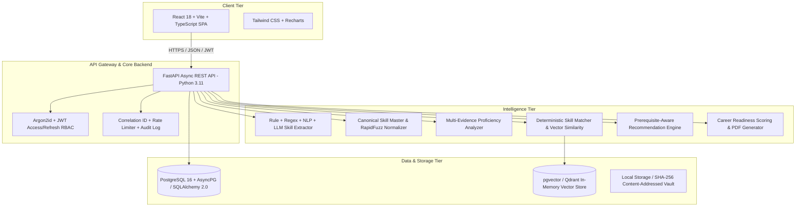

# System Architecture: AI-Powered Learning-to-Career Intelligence System

## 1. Executive Overview
The **AI-Powered Learning-to-Career Intelligence System** is an enterprise-grade platform that bridges the gap between learner capabilities and industry job market expectations. It provides reproducible skill extraction, deterministic proficiency evaluation, explainable gap analysis, personalized learning pathways, and dynamic career readiness scoring.

## 2. High-Level Architecture

## 3. Component Breakdown

### 3.1 Frontend (`/frontend`)
- **Framework**: React 18 with Vite and TypeScript.
- **Styling**: Tailwind CSS with enterprise color palettes, accessible contrasts, and responsive layouts.
- **State & Routing**: React Router v6, Axios interceptors with automatic JWT token refresh.
- **Visualizations**: Recharts for proficiency radar, gap bar charts, and readiness trends.
- **Pages**:
  - `auth/`: Login, Register, Forgot Password, Reset Password.
  - `learner/`: Dashboard, Profile, Skills, History.
  - `resumes/`: Upload, Extraction Audit, Evidence Preview.
  - `courses/`: Catalog, Modules, Outcomes, Completion Submissions.
  - `assessments/`: Interactive MCQs and Practical Coding Submissions.
  - `jobs/`: Job Catalog, Requirement Explorer, Comparison Matrix.
  - `recommendations/`: Prioritized Action Items, Evidence, Course & Project Links.
  - `reports/`: Explainable Career Readiness Reports with PDF Export.
  - `admin/`: User Management, Skill Master, Job Descriptions, System Analytics, Audit Logs.

### 3.2 Backend (`/backend`)
- **FastAPI**: Fully asynchronous routing using async/await with AsyncPG connection pooling.
- **Pydantic v2**: Strict schema validation with serialization and deserialization guards.
- **SQLAlchemy 2.0 Core/ORM**: Declarative models with typed mappings, UUID primary keys, foreign keys, and indexes.
- **Security**: Argon2id password hashing via `argon2-cffi`, HMAC-SHA256 JWT tokens with role claims (`learner`, `mentor`, `admin`).
- **File Ingestion**: Content-addressed storage using SHA-256 hashes to prevent duplicate file ingestion; PyMuPDF (`fitz`), `python-docx`, and plain text parsers with metadata extraction.

### 3.3 AI Engine (`/ai_engine` & Backend Services)
- **Extraction**: Hybrid pipeline combining:
  1. Exact canonical dictionary matching (zero false positives for standardized technologies).
  2. Alias expansion (e.g., `py` -> `Python`, `k8s` -> `Kubernetes`).
  3. spaCy NLP tokenization and noun-phrase entity boundary extraction (`en_core_web_sm`).
  4. Contextual embedding similarity using Sentence Transformers (`all-MiniLM-L6-v2`) or RapidFuzz token set ratio.
  5. LLM prompt fallback (Ollama / Local LLM provider) with structured Pydantic schema validation.
- **Proficiency Evaluation**: Deterministic multi-factor evidence scoring:
  - Evidence weights: Work Experience (40%), Practical Projects (30%), Assessments (20%), Courses (10%).
  - Levels: Beginner (1), Intermediate (2), Advanced (3), Expert (4).
  - Strict guardrail: Resume mentions alone cap at Beginner/Intermediate; advanced/expert requires verified assessments or real projects.
- **Matching & Gap Engine**:
  - Compares demonstrated proficiency against required job proficiency.
  - Categorizes: Matched, Partially Matched, Missing, Insufficient Evidence, Exceeds Requirement.
  - Mathematical readiness score:
    $$\text{Readiness Score} = \left(\frac{\sum w_i \cdot \min(D_i, R_i)}{\sum w_i \cdot R_i}\right) \times 100$$
    where $w_i = 1.5$ for Mandatory skills and $w_i = 1.0$ for Preferred skills.

### 3.4 Storage & Database
- Primary Database: PostgreSQL with asyncpg driver (with transparent SQLite async fallback for developer isolation and test suites).
- Vector Storage: In-memory cosine similarity and Qdrant / pgvector compatible abstraction.
- Deduplication: SHA-256 hash checks on resume files, jobs, and courses.
