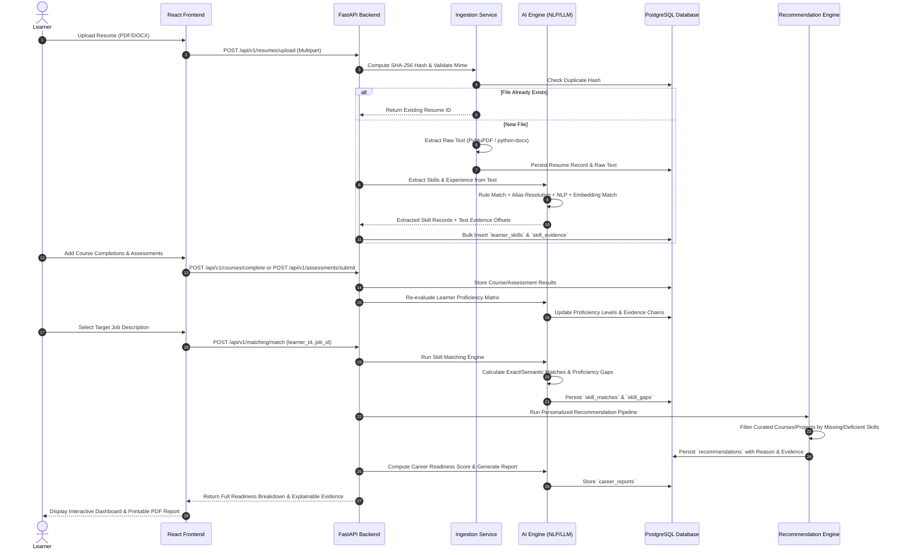

# Data Flow: AI-Powered Learning-to-Career Intelligence System

## 1. End-to-End Core Workflow

## 2. Ingestion Processing Stages
1. **Validation**: Check file size (max 10MB), permitted extensions (`.pdf`, `.docx`, `.txt`), and MIME types.
2. **Hash Verification**: Compute SHA-256 over byte stream. Reject exact duplicate uploads or retrieve prior parsed entities idempotently.
3. **Text Extraction**:
   - PDF: PyMuPDF (`fitz`) page-by-page extraction with font block grouping.
   - DOCX: `python-docx` paragraph and table traversal.
   - TXT: UTF-8 normalization and character cleansing.
4. **Section Parsing**: Segment text into Education, Experience, Skills, Certifications, and Projects using regex and semantic boundary detection.

## 3. Skill Extraction & Normalization Flow
1. **Tokenization & Lemmatization**: Using spaCy's `en_core_web_sm` pipeline.
2. **Canonical Dictionary Lookup**: Exact string matching against 500+ canonical technical and soft skills.
3. **Alias Resolution**: Mapping common abbreviations and variants (e.g., `Postgres` -> `PostgreSQL`, `TS` -> `TypeScript`, `Node` -> `Node.js`).
4. **Vector / RapidFuzz Fuzzy Matching**: Token-sort-ratio matching above 88% confidence for OCR typos or non-standard naming.
5. **LLM Contextual Extraction**: Ollama/Local LLM fallback for ambiguous text, outputting structured JSON with exact quote snippets as evidence.
6. **Persistence**: Store with `source_type='resume'`, snippet, character indices, and confidence score ($0.0 - 1.0$).

## 4. Proficiency Scoring Engine
Proficiency level $P \in \{1, 2, 3, 4\}$ corresponding to {Beginner, Intermediate, Advanced, Expert}.
Calculated deterministically from four verifiable evidence sources:
- **Work Experience ($W_{exp} = 0.40$)**: Years of demonstrated usage in role descriptions.
- **Practical Projects ($W_{proj} = 0.30$)**: Complexity, GitHub repository, and project verification.
- **Assessments ($W_{ass} = 0.20$)**: Normalized assessment score adjusted for test difficulty.
- **Course Completions ($W_{course} = 0.10$)**: Verified completion of structured courses.

Guardrails:
- Resume mention alone: Maximum score = 2.0 (Intermediate).
- Advanced ($3.0$) requires at least 1 verified assessment score $\ge 75\%$ OR a verified practical project.
- Expert ($4.0$) requires $\ge 3$ years experience AND verified project AND assessment $\ge 85\%$.

## 5. Skill Matching & Gap Classification
For each required skill in target job:
- **Matched**: Learner has canonical skill with $P_{\text{learner}} \ge P_{\text{required}}$.
- **Partially Matched**: Learner has skill, but $P_{\text{learner}} < P_{\text{required}}$.
- **Missing**: Learner has no evidence of the canonical skill or recognized alias.
- **Insufficient Evidence**: Skill mentioned without verifiable project, assessment, or duration.
- **Exceeds Requirement**: $P_{\text{learner}} > P_{\text{required}}$.
