# Database Schema: AI-Powered Learning-to-Career Intelligence System

## 1. Entity-Relationship Diagram

```mermaid
erDiagram
    USERS ||--o{ LEARNERS : "profiles"
    USERS ||--o{ AUDIT_LOGS : "acts"
    LEARNERS ||--o{ RESUMES : "submits"
    LEARNERS ||--o{ LEARNER_SKILLS : "possesses"
    LEARNERS ||--o{ COURSE_COMPLETIONS : "completes"
    LEARNERS ||--o{ ASSESSMENT_RESULTS : "scores"
    LEARNERS ||--o{ PRACTICAL_PROJECTS : "builds"
    LEARNERS ||--o{ SKILL_MATCHES : "evaluated_in"
    LEARNERS ||--o{ SKILL_GAPS : "has"
    LEARNERS ||--o{ RECOMMENDATIONS : "receives"
    LEARNERS ||--o{ CAREER_REPORTS : "generates"

    SKILL_CATEGORIES ||--o{ SKILLS : "categorizes"
    SKILLS ||--o{ SKILL_ALIASES : "has"
    SKILLS ||--o{ LEARNER_SKILLS : "linked_to"
    SKILLS ||--o{ JOB_REQUIREMENTS : "required_in"
    SKILLS ||--o{ LEARNING_OUTCOMES : "targeted_by"
    SKILLS ||--o{ RECOMMENDATIONS : "recommended_for"

    LEARNER_SKILLS ||--o{ SKILL_EVIDENCE : "evidenced_by"

    COURSES ||--o{ COURSE_MODULES : "contains"
    COURSES ||--o{ LEARNING_OUTCOMES : "specifies"
    COURSES ||--o{ COURSE_COMPLETIONS : "recorded_in"
    COURSES ||--o{ ASSESSMENTS : "evaluated_by"

    ASSESSMENTS ||--o{ ASSESSMENT_QUESTIONS : "contains"
    ASSESSMENTS ||--o{ ASSESSMENT_RESULTS : "produces"

    JOB_ROLES ||--o{ JOB_DESCRIPTIONS : "has"
    JOB_DESCRIPTIONS ||--o{ JOB_REQUIREMENTS : "defines"
    JOB_DESCRIPTIONS ||--o{ SKILL_MATCHES : "matched_against"
    JOB_DESCRIPTIONS ||--o{ CAREER_REPORTS : "reported_in"

    RECOMMENDATIONS ||--o{ RECOMMENDATION_EVIDENCE : "justified_by"
    LEARNING_RESOURCES ||--o{ RECOMMENDATIONS : "referenced_in"
```

## 2. Table Specifications

### 2.1 Core Identity & Access Control
- `users`: ID (UUID), email (unique), hashed_password (Argon2id), full_name, role (`admin`, `learner`, `mentor`), is_active, created_at, updated_at.
- `learners`: ID (UUID), user_id (FK -> users), headline, bio, location, target_role, years_of_experience, education_level, github_url, linkedin_url.
- `audit_logs`: ID (UUID), user_id, action, entity_name, entity_id, correlation_id, ip_address, details (JSONB), created_at.

### 2.2 Skill Taxonomy
- `skill_categories`: ID (UUID), name (unique), description, slug.
- `skills`: ID (UUID), category_id (FK -> skill_categories), name (unique, canonical), slug, description, popularity_score, is_verified.
- `skill_aliases`: ID (UUID), skill_id (FK -> skills), alias (unique), normalized_alias.

### 2.3 Evidence & Learner Capability
- `resumes`: ID (UUID), learner_id (FK -> learners), filename, file_hash (SHA-256 unique per learner), mime_type, file_path, raw_text, parsed_sections (JSONB), processing_status (`pending`, `processed`, `failed`), error_message, created_at.
- `learner_skills`: ID (UUID), learner_id (FK -> learners), skill_id (FK -> skills), proficiency_level (1-4), confidence_score (0.0-1.0), years_experience, last_used_date, created_at, updated_at.
- `skill_evidence`: ID (UUID), learner_skill_id (FK -> learner_skills), source_type (`resume`, `course`, `assessment`, `project`), source_id (UUID), text_snippet, confidence (0.0-1.0), created_at.

### 2.4 Curriculum & Learning Ingestion
- `courses`: ID (UUID), title, provider, code, description, difficulty (`beginner`, `intermediate`, `advanced`), estimated_hours, url.
- `course_modules`: ID (UUID), course_id (FK -> courses), title, order_index, description.
- `learning_outcomes`: ID (UUID), course_id (FK -> courses), skill_id (FK -> skills), target_proficiency (1-4), outcome_statement.
- `course_completions`: ID (UUID), learner_id (FK -> learners), course_id (FK -> courses), completion_date, certificate_url, grade, verified_by.
- `assessments`: ID (UUID), course_id (nullable FK), title, description, passing_score, time_limit_minutes, skill_id (FK -> skills).
- `assessment_questions`: ID (UUID), assessment_id (FK -> assessments), question_text, question_type (`mcq`, `code`), options (JSONB), correct_answer, explanation.
- `assessment_results`: ID (UUID), learner_id (FK -> learners), assessment_id (FK -> assessments), score_percentage, passed (bool), answers (JSONB), taken_at.
- `practical_projects`: ID (UUID), learner_id (FK -> learners), title, description, repository_url, live_url, demonstrated_skills (JSONB), verified (bool), review_notes.

### 2.5 Industry Demand & Skill Matching
- `job_roles`: ID (UUID), title (unique), industry, standard_code.
- `job_descriptions`: ID (UUID), role_id (FK -> job_roles), company_name, location, employment_type, raw_text, file_hash, source_url, is_active.
- `job_requirements`: ID (UUID), job_id (FK -> job_descriptions), skill_id (FK -> skills), required_level (1-4), requirement_type (`mandatory`, `preferred`, `optional`), importance_weight.
- `skill_matches`: ID (UUID), learner_id (FK -> learners), job_id (FK -> job_descriptions), skill_id (FK -> skills), match_type (`matched`, `partial`, `missing`, `insufficient`, `exceeds`), learner_level (1-4), required_level (1-4), score_delta, confidence.
- `skill_gaps`: ID (UUID), learner_id (FK -> learners), job_id (FK -> job_descriptions), skill_id (FK -> skills), required_level, current_level, gap_severity (`critical`, `moderate`, `minor`).

### 2.6 Recommendations & Career Intelligence
- `learning_resources`: ID (UUID), title, type (`course`, `tutorial`, `documentation`, `project`, `certification`), provider, url, estimated_hours, skill_id (FK -> skills), target_level.
- `recommendations`: ID (UUID), learner_id (FK -> learners), job_id (FK -> job_descriptions), skill_id (FK -> skills), resource_id (FK -> learning_resources), priority (`high`, `medium`, `low`), reason, expected_outcome, status (`active`, `in_progress`, `completed`, `dismissed`).
- `recommendation_evidence`: ID (UUID), recommendation_id (FK -> recommendations), gap_reason, current_level, target_level, calculation_trace.
- `career_reports`: ID (UUID), learner_id (FK -> learners), job_id (FK -> job_descriptions), overall_readiness_score (float), breakdown (JSONB), executive_summary, calculation_evidence (JSONB), pdf_path, generated_at.
- `processing_jobs`: ID (UUID), job_type, status (`pending`, `processing`, `completed`, `failed`), payload (JSONB), result (JSONB), error_message, correlation_id, created_at, finished_at.
